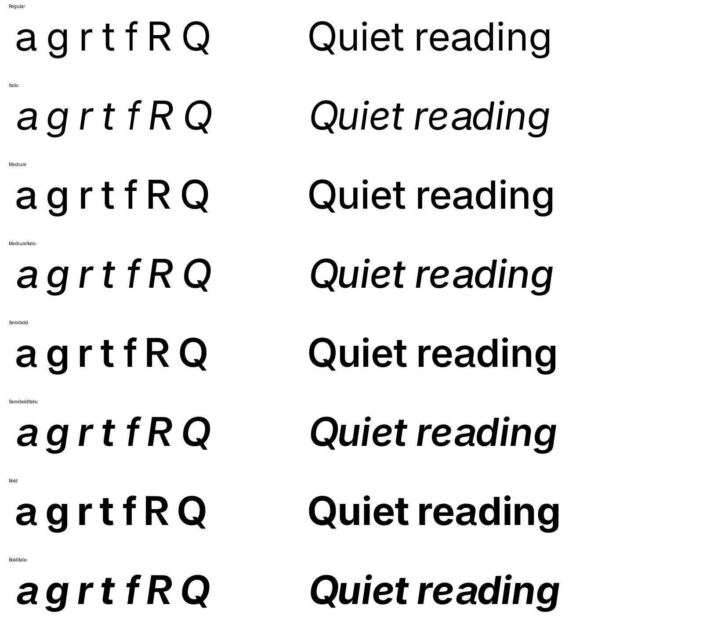
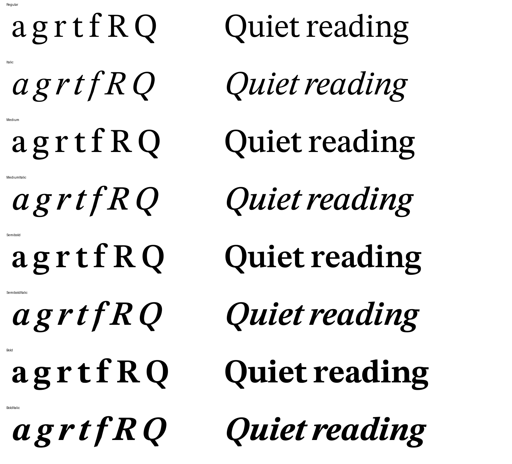

# Lyell Sans & Lyell Serif

Two companion type families, made by redrawing and respacing open-source fonts. **Lyell Sans** is derived from [Inter](https://github.com/rsms/inter), and **Lyell Serif** from [STIX Two Text](https://github.com/stipub/stixfonts). Both are licensed under the SIL Open Font License 1.1.





> **Status: proof release (0.201).** The fonts work for testing and design review but are not finished for production. See [Limitations](#limitations).

## Download

The latest fonts are in [`prototypes/v0.201/`](prototypes/v0.201/), as separate TTF files or as a single zip, [`lyell-families-0.201.zip`](prototypes/v0.201/lyell-families-0.201.zip).

| Family | Weights | Italics | Format |
| --- | --- | --- | --- |
| Lyell Sans | Regular 400, Medium 500, Semibold 600, Bold 700 | All four | Static TTF |
| Lyell Serif | Regular 400, Medium 500, Semibold 600, Bold 700 | All four | Static TTF |

Before 0.201, the fonts were named **Proof Sans** and **Proof Serif**. Lyell installs alongside them rather than replacing them, so uninstall the Proof fonts to avoid duplicate menu entries.

## What changed from the source fonts

**Lyell Sans (from Inter)**

- Capitals are 3% taller. Word spaces are narrower.
- **a** has a curved exit foot and a reworked opening and terminal.
- **g** has a shorter descender with a raised hook. **t** is wider and taller, and **f** is narrower.
- **R** has a higher bowl junction and a redrawn leg. **Q** has a reshaped tail.
- The italics are Inter's real italics, slanted at 8°, with the revised a, R, Q and f.

**Lyell Serif (from STIX Two Text)**

- Capitals are 3% taller. Letter and word spacing are tighter.
- **Q** has a new diagonal tail. **r** has a redrawn head serif and terminal, and **t** has a curved foot with a longer crossbar.
- **a**, **e**, **r**, **t**, **f** and **g** have revised proportions.
- The italics are STIX's real italics, slanted at 18°, with a redrawn Q tail and a new sloped f descender (including the contextual f forms).

The changes were drawn on the regular weight and carried to the other weights by interpolating against Inter's and STIX's own weights. Letter pairs were checked for collisions, and fixes were made for each style. Each version's `README.txt` in `prototypes/` describes its changes in detail.

## Limitations

- No production hinting.
- Kerning has only been spot-checked, not fully reviewed. Mark positioning and non-Latin scripts haven't been reviewed.
- No Light or Black weights, and no variable fonts yet.
- The changes focus on Latin letters. Other glyphs come from Inter and STIX Two Text, with only the changes they inherit from the edited letters.

## Building

The build uses Python 3 with fontTools, Pillow, freetype-py and uharfbuzz.

```sh
python3 -m venv .venv
.venv/bin/pip install fonttools pillow freetype-py uharfbuzz

.venv/bin/python sources/family/download.py          # fetch Inter and STIX Two Text weights
.venv/bin/python prototypes/build_family.py          # build the 0.200 family
.venv/bin/python prototypes/family_spacing.py        # spacing corrections
.venv/bin/python prototypes/expand_family_kerning.py # carry kerning to accented forms
.venv/bin/python prototypes/rename_family.py         # apply Lyell naming as 0.201
.venv/bin/python prototypes/verify_family.py v0.201  # validate
```

The family build also reads the preserved 0.103 regular-weight drawings in `prototypes/v0.103/`. [`prototypes/v0.200/sources.json`](prototypes/v0.200/sources.json) records the input versions and hashes. Each version's `manifest.json` records the output hashes.

## Repository layout

| Path | Contents |
| --- | --- |
| `prototypes/` | Build and validation scripts, plus every preserved version (0.101 to 0.201) with its own `README.txt`. |
| `sources/family/` | Inter and STIX Two Text weights used by the family build, and the script that downloads them. |
| `output/` | Proof pages, comparison studies, rendered specimens, reference open fonts and their licences. |

Some comparison scripts in `output/` render proprietary Klim trial fonts as visual references. Those fonts aren't included and must be installed separately. No Klim outlines are used in Lyell.

## License

Both families are licensed under the [SIL Open Font License 1.1](https://openfontlicense.org/). Each family's notice ([`LyellSans-OFL.txt`](prototypes/v0.201/LyellSans-OFL.txt), [`LyellSerif-OFL.txt`](prototypes/v0.201/LyellSerif-OFL.txt)) must be distributed with its fonts. The fonts' metadata keeps the original copyright notices from the Inter Project Authors and the STIX Fonts Project Authors. Lyell is not endorsed by those authors or by Klim.
